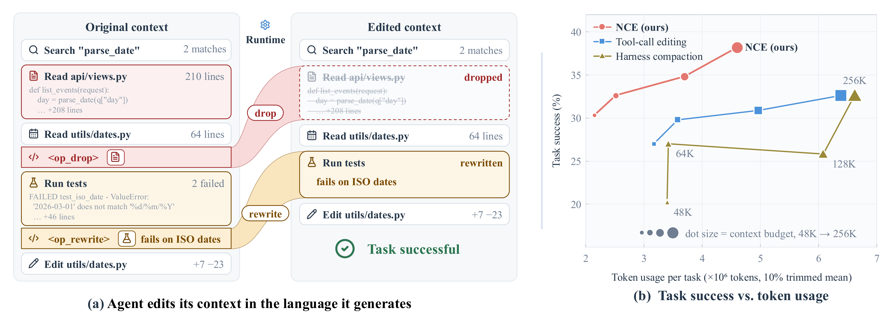
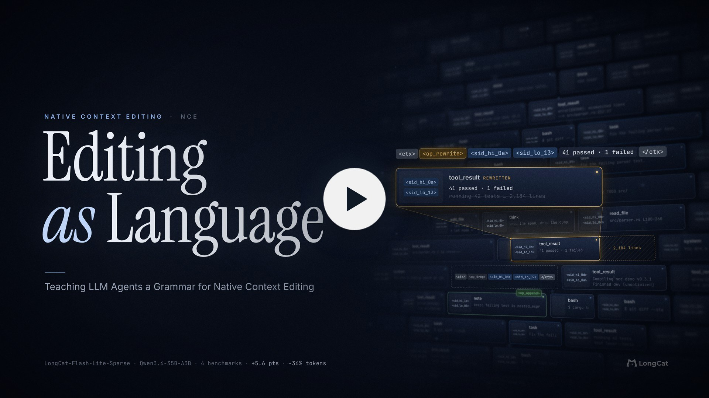
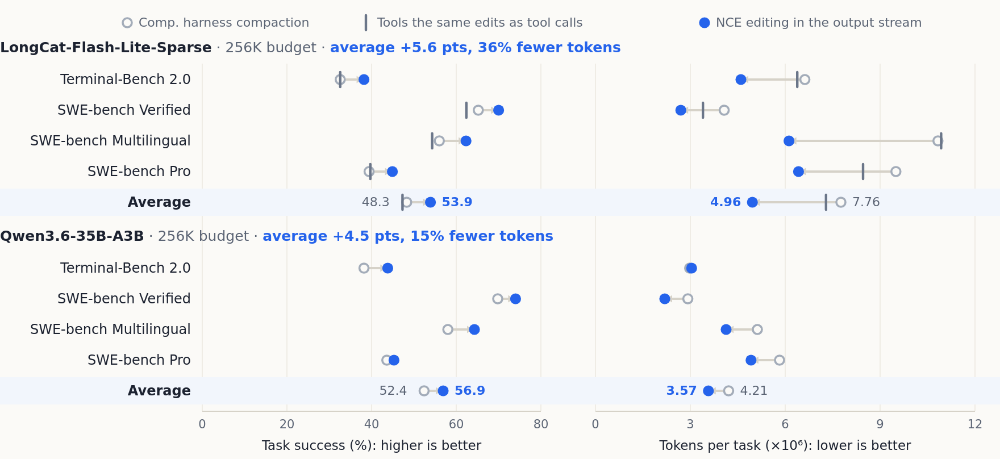
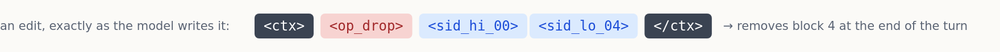

<div align="center">

<!-- One lockup with its own ground, rather than two assets and a theme test.
     Every switching mechanism (`<picture>` with prefers-color-scheme, GitHub's
     #gh-dark-mode-only fragments) depends on the renderer implementing it; when
     one does not, a dark page gets the light-ground artwork and the wordmark
     vanishes into the background. This file carries a near-black plate, so the
     white wordmark is legible on any ground and nothing has to be switched. -->


# Native Context Editing

**A grammar of dedicated special tokens that lets an LLM agent edit its own context while it generates — 53.9 against 48.3 for harness compaction across four benchmarks, with 36% fewer tokens.**

*Editing as Language: Teaching LLM Agents a Grammar for Native Context Editing*

[](https://arxiv.org/abs/2610.25550)
[](https://dengyl20.github.io/native-context-editing/)
[](https://dengyl20.github.io/native-context-editing/demo.html)
[](https://dengyl20.github.io/native-context-editing/#video)
[](tests/)
[](https://www.python.org/)
[](LICENSE)

</div>

<a href="docs/static/img/paper-figure-1.png">
  
</a>

<p align="center"><sub><b>Figure 1.</b> An agent drops a spent read and rewrites a failing test result into the conclusion it drew (left), and so finishes tasks at lower token cost (right). The numbers behind the right panel are in <a href="#results">Results</a>.</sub></p>

<p align="center"><sub><b>The film.</b> 130 seconds, with sound. Click to watch on the project page.</sub></p>

<p align="center"><a href="https://dengyl20.github.io/native-context-editing/#video" title="Watch the film on the project page"></a></p>

*[The project film](https://dengyl20.github.io/native-context-editing/#video) — one agent, one long task, and the edits it makes as it goes.*

---

## Results

<a href="docs/static/img/readme/results.png">
  
</a>

<p align="center"><sub><b>Figure 2.</b> Task success and token usage per task (×10⁶), 256K budget, four benchmarks plus their average. The arrow runs from harness compaction to NCE. Values are printed on the average rows; every cell is in the tables below.</sub></p>

Every benchmark moves the same way: success up, tokens down. On LongCat-Flash-Lite-Sparse the average rises from 48.3 to 53.9 (+5.6 points) while tokens per task fall from 7.76M to 4.96M (36% fewer). The same edits issued as tool calls stay below harness compaction, so the gain comes from expressing them natively. Qwen3.6-35B-A3B shows the same ordering without that baseline: +4.5 points, 15% fewer tokens.

**LongCat-Flash-Lite-Sparse**, 256K budget. Success % / tokens per task (×10⁶). **Comp.** is harness compaction, a model-written summary once the history reaches the budget; **Tools** is tool-call editing, trained on the same edits as NCE.

| Benchmark | Comp. | Tools | NCE |
|---|---|---|---|
| Terminal-Bench 2.0 | 32.6 / 6.62 | 32.6 / 6.38 | **38.2 / 4.60** |
| SWE-bench Verified | 65.2 / 4.07 | 62.4 / 3.40 | **70.0 / 2.70** |
| SWE-bench Multilingual | 56.0 / 10.83 | 54.3 / 10.93 | **62.3 / 6.12** |
| SWE-bench Pro | 39.4 / 9.50 | 39.7 / 8.46 | **44.9 / 6.42** |
| **Average** | 48.3 / 7.76 | 47.3 / 7.29 | **53.9 / 4.96** |

**Qwen3.6-35B-A3B**, 256K budget, no Tools baseline. Success % / tokens per task (×10⁶).

| Benchmark | Comp. | NCE |
|---|---|---|
| Terminal-Bench 2.0 | 38.2 / 2.98 | **43.8 / 3.04** |
| SWE-bench Verified | 69.8 / 2.92 | **74.0 / 2.19** |
| SWE-bench Multilingual | 58.0 / 5.12 | **64.3 / 4.13** |
| SWE-bench Pro | 43.6 / 5.82 | **45.3 / 4.92** |
| **Average** | 52.4 / 4.21 | **56.9 / 3.57** |

Terminal-Bench 2.0 at tighter budgets keeps the ordering: NCE has the highest success rate at every budget.

| Budget | Comp. | Tools | NCE |
|---|---|---|---|
| 256K | 32.6 | 32.6 | **38.2** |
| 128K | 25.8 | 30.3 | **34.8** |
| 64K | 27.0 | 29.2 | **32.6** |
| 48K | 20.2 | 27.0 | **30.3** |

NCE at 64K solves as many Terminal-Bench tasks as either baseline at 256K. At every budget it holds the same ordering and a lower cost: 38.2 against 32.6 at 256K, 34.8 against 25.8 at 128K, 32.6 against 27.0 at 64K, and 30.3 against 20.2 at 48K.

---

## What NCE is

A long-horizon agent accumulates code, tool output, execution feedback and intermediate decisions into a history that outgrows any fixed window. NCE makes managing that history part of the language the model speaks.

The context becomes an ordered list of **addressable blocks**: the system prompt, the task, every observation, and any note the agent writes. Each block carries a persistent two-token address. The model reads a rendering of that list and emits, alongside its ordinary output, zero or more **edits**. A task-agnostic runtime executes the edits at the end of the turn, and the next prompt is rendered from the state they produce:

```
S_{t+1} = Execute(S_t, e_t) ⊕ (a_t, b_t)
```

The action `a_t` and the new observation `b_t` are appended exactly as they would be without editing; with `e_t` empty this is ordinary context growth.

**Why this is native.** The meaning ships with the model. `<op_drop>` is one token of the vocabulary, and the model decides to write it in the same forward pass that writes the action, with no prompt text explaining a schema and no round trip through a tool. A checkpoint that has learned the grammar carries it into any harness unchanged, the way it carries `<eos>`. The difference is where the meaning lives: in the model's vocabulary, next to the words it already knows.

## The grammar

<a href="docs/static/img/readme/grammar.png">
  
</a>

An edit is one envelope around exactly one operator. One line of the model's own output:

```
<ctx><op_drop><sid_hi_00><sid_lo_04></ctx>
```

Block 4 is addressed as `hi = 4 // 32 = 0`, `lo = 4 % 32 = 4`. Two adjacent address tokens name one block, and the model targets a block by copying the two tokens that open it. The grammar reserves **70 special tokens**:

| Tokens | Count | Meaning |
|---|---|---|
| `sid_hi_00`…`sid_hi_31` + `sid_lo_00`…`sid_lo_31` | 64 | Address pair, naming 1,024 blocks. |
| `<op_drop>`, `<op_rewrite>`, `<op_append>` | 3 | The three operators. |
| `<ctx>`, `</ctx>` | 2 | Envelope delimiters. Every edit is wrapped in exactly one pair. |
| `<m_ro>` | 1 | Lock marker. The runtime locks the system prompt at the start of a session. |

**Execution rules.**

- A turn may carry several edits, each introduced by a one-sentence rationale in plain text. The envelopes are stripped from the output before it enters the context; the rationale and the action remain.
- An edit executes only if it is well formed: exactly one operator, at least one address for `drop`, one address followed by text for `rewrite`, non-empty text for `append`. A malformed envelope executes as a no-op.
- Every address must name a block this session issued, and no edit may touch a locked block. A rejected edit changes nothing.
- A rewrite of a block that is no longer live is applied as an append, so its text survives; the runtime reports `applied_as_append`.
- An edit repeated verbatim within a turn executes once.
- If at least one edit executed, the next prompt is rendered afresh. If none did, the next prompt extends the previous one and its prefix cache stays valid.

Under a budget `W` the runtime appends a transient reminder at 70% (soft) and 95% (hard) of `W`. The reminder carries no numbers, so the model cannot read off how much room is left, and the same text serves NCE and tool-call editing.

---

## See it work

The [interactive replay](https://dengyl20.github.io/native-context-editing/demo.html) steps through four recorded runs turn by turn: the context as blocks, the edits the model wrote, and the state they produced. Scroll to any editing turn and watch the block list change.

The four runs ship as plain JSON in [`docs/data/cases/`](docs/data/cases/), each with its peak context against the same run with editing disabled. `valkey-790` is an excerpt, turns 0–30 of a 197-turn run:

| Run | Benchmark | Peak tokens | Without editing |
|---|---|---|---|
| `tune-mjcf` | Terminal-Bench 2.0 | 35,086 | 54,015 |
| `django-14855` | SWE-bench Verified | 75,734 | 123,551 |
| `valkey-790` | SWE-bench Multilingual | 49,997 | 58,381 |
| `large-scale-text-editing` | Terminal-Bench 2.0 | 40,214 | 49,973 |

---

## Install and quick start

Nothing to install. The package, the examples and the tests use only the Python standard library, on Python 3.9 or newer. From the repository root:

```bash
python3 -m unittest discover -s tests
python3 examples/01_token_grammar.py
```

```
Ran 299 tests in 0.8s
OK
```

**Run one turn.** This is a real session: two tool reads arrive, the model drops the first and rewrites the second into what it learned. Run it from the repository root, where the `nce` package is importable as-is:

```python
from nce import Runtime, encode_address

rt = Runtime(budget=64_000)                      # 64K budget, reminders enabled
rt.add_block("system", "You are a coding agent.", locked=True)
rt.add_block("user", "Fix parse_duration('1h30m') in the timeparse package.")
first  = rt.add_block("tool", "src/timeparse/core.py:9:def parse_duration(text): ...",
                      tool_name="read")
second = rt.add_block("tool", "src/timeparse/core.py:9:def parse_duration(text): ...",
                      tool_name="read")

output = (
    "The composite branch is now visible; the first read is superseded.\n"
    f"<ctx><op_drop>{encode_address(first.address)}</ctx>\n"
    f"<ctx><op_rewrite>{encode_address(second.address)} "
    "src/timeparse/core.py:9 parse_duration() sums per-unit terms; "
    "'1h30m' still returns 1800, since the minute term is divided by 60 twice.</ctx>\n"
    "Let me add the regression test."
)

step = rt.step(output)
for r in step.results:
    print(r.edit.op, r.status, r.reason)   # drop applied None / rewrite applied None
print(step.action_text)                     # rationale and action, envelopes removed
print(rt.prompt())                          # the next prompt, from the new state
```

`rt.step` parses the output, executes the edits, records the remaining text as an action, and returns a `StepResult` whose `results` list reports one status per edit: `applied`, `applied_as_append`, or `rejected` with a reason (`unknown_address`, `not_live`, `locked`, `duplicate`, `address_exhausted`, and the grammar's own reasons such as `missing_address`, `bad_address`, `unexpected_content`).

**Serve a batch of turns.**

```python
rt = Runtime(budget=128_000)
rt.add_block("system", system_prompt, locked=True)
rt.add_block("user", task)
while not done:
    output = model(rt.prompt())
    step = rt.step(output)                       # edits executed, action recorded
    observation = environment(step.action_text)  # the action is what the harness sees
    rt.add_block("tool", observation, tool_name="bash")
```

`rt.prompt()` renders the next prompt and issues a reminder when one is due; `rt.context_tokens()` returns its size. Pass a real tokenizer's counter as `Runtime(..., counter=nce.render.hf_counter(tok))`; the default `approx_tokens` is a dependency-free estimate.

**Five runnable scripts.** Each prints a transcript and asserts every claim it makes.

- `examples/01_token_grammar.py` — the 70 tokens, the address code, the rendering, and the streaming parser across chunk boundaries.
- `examples/02_runtime_edits.py` — `drop`, `rewrite`, `append`, and the cases the runtime refuses: locked, unissued, retired, duplicate, malformed, stray.
- `examples/03_annotation_walkthrough.py` — how a recorded trajectory becomes blocks, release points, decision points and an edit script.
- `examples/04_trace_render.py` — an edit trace as coloured terminal output; `--no-color` pipes cleanly.
- `examples/05_distill_segments.py` — cutting an annotated trajectory into segments, each piece marked with a loss flag.
---

## The annotation pipeline

Recorded trajectories contain no edits. The reference pipeline derives them. An offline teacher reads the whole trajectory and assigns each block a release point with a cited cause; an online teacher writes edits at decision points seeing only the present; a final audit removes edits that fail a mechanical check.

```python
from nce.annotate import (annotate, load_trajectory,
                          RuleBasedOfflineTeacher, RuleBasedOnlineTeacher)
from nce.distill import distill

traj = load_trajectory("examples/data/toy_trajectory.json")
ann = annotate(traj, RuleBasedOfflineTeacher(), RuleBasedOnlineTeacher())
print(ann.report()["edit_turns"], ann.report()["decision_points"])

segments = distill(ann.annotated())     # training segments as (text, loss) pieces
print([(s.first_turn, s.last_turn, s.edits) for s in segments])
```

Both teachers are interfaces, `OfflineTeacher` and `OnlineTeacher`, so an LLM implementation plugs into the same pipeline; the two bundled rule-based teachers are deterministic baselines that run without a model or a network. `distill` replays the annotated trajectory forward through the turn equation: every turn whose edits execute closes a segment, and the next one opens with the rendering of the state those edits produced, so within a segment every later edit is conditioned on the earlier ones.

---

## What is in the box

```
native-context-editing/
├── nce/                 the reference implementation, standard library only
│   ├── tokens.py        the 70 tokens and the two-token address code
│   ├── grammar.py       AST, envelope parser, streaming parser, serialization
│   ├── state.py         blocks, actions, reminders, the address pool
│   ├── render.py        the text the model reads, and token counting
│   ├── runtime.py       Execute, the turn step, reminders, the session object
│   ├── distill.py       segments with evolving contexts, as (text, loss) pieces
│   └── annotate/        supervision from recorded trajectories
├── examples/            five runnable scripts, and a 15-turn toy trajectory
├── spec/                tokens, grammar, semantics, conformance
├── tests/               299 unittest tests and their JSON fixtures
├── docs/                project page, interactive replay, recorded runs, film
│   ├── data/cases/      four recorded runs replayed by the demonstration
│   └── static/          stylesheets, fonts, images, the film
├── assets/              the LongCat wordmark
├── CITATION.cff         citation metadata
├── publish.sh           builds the public repository and turns on Pages
├── LICENSE              MIT
└── requirements.txt     states the standard-library-only requirement
```

The `nce` package is the whole reference implementation: `tokens.py` fixes the vocabulary,
`grammar.py` says what a well-formed edit is, `state.py` holds the context, `runtime.py` executes
a turn, `render.py` produces the next prompt, and `annotate/` builds supervision offline.

## Spec and conformance

[`spec/`](spec/) is a normative, implementation-neutral statement of the language, written so two independent implementations agree on what a well-formed edit is and what it does: [`tokens.md`](spec/tokens.md), [`grammar.md`](spec/grammar.md), [`semantics.md`](spec/semantics.md), [`conformance.md`](spec/conformance.md). The tests drive the same JSON fixtures a second implementation can read, including every two-way split of every envelope through the streaming parser.

```bash
python3 -m unittest discover -s tests -v
```

## Citation

```bibtex
@misc{deng2026nce,
  title         = {Editing as Language: Teaching {LLM} Agents
                   a Grammar for Native Context Editing},
  author        = {Yunlong Deng and Yan Li and Xing Hu and Yida Zhu
                   and Sean Du and Weiyang Liu and Guangyi Chen},
  year          = {2026},
  eprint        = {2610.25550},
  archivePrefix = {arXiv},
  primaryClass  = {cs.CL},
  url           = {https://github.com/dengyl20/native-context-editing}
}
```

Preprint: [arXiv:2610.25550](https://arxiv.org/abs/2610.25550). Maintained citation metadata lives in [`CITATION.cff`](CITATION.cff).

## Scope and license

This release ships the grammar, the runtime, the annotation pipeline and the examples. The paper's training stack and training data are not part of it: nothing here trains a model, calls a model, or touches a network.

MIT. See [LICENSE](LICENSE).
